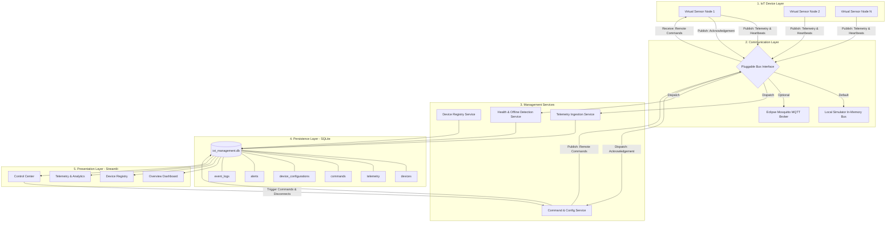
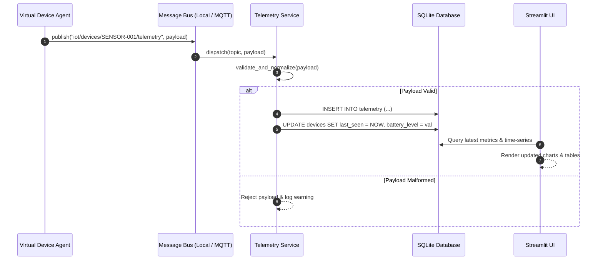
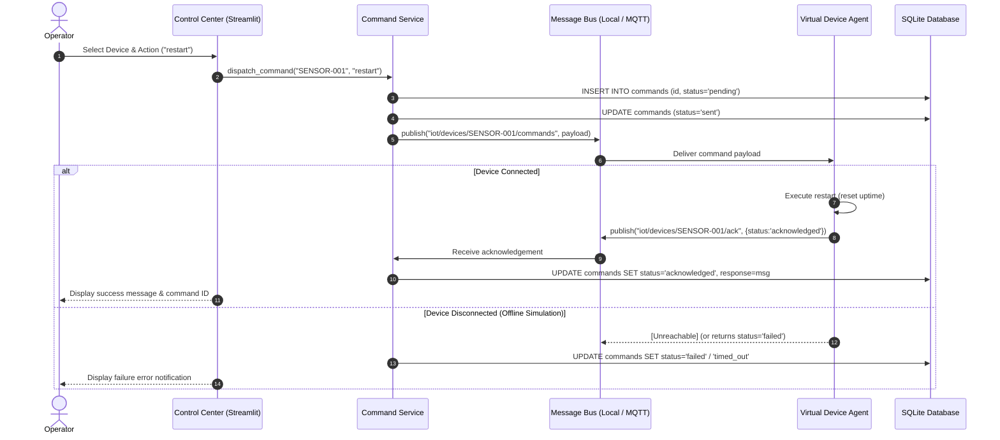

# Distributed IoT Device Management Architecture
## College DSS Subject Architectural Specification

---

## 1. System Overview & Architectural Paradigm

The **Distributed IoT Device Management Architecture** is designed to demonstrate a robust, modular, and loosely-coupled IoT management system. Rather than creating a static dashboard with dummy charts, this system implements an end-to-end distributed systems pattern comprising:

1. **Autonomous Virtual Device Agents:** Emulating physical sensor nodes that generate periodic telemetry and heartbeat pulses, and handle remote actuator/management commands.
2. **Pluggable Communication Bus:** An abstract messaging layer with interchangeable implementations:
   * **In-Memory Local Simulator Bus:** Zero-configuration default mode for standalone laptop execution.
   * **MQTT Broker Adapter:** Broker-mediated publish/subscribe transport adhering to standard IoT communication patterns (using Eclipse Mosquitto and Paho MQTT).
3. **Core Management Services:** Specialized micro-services for device inventory registration, telemetry normalization, health and offline evaluation, command lifecycle tracking, and configuration management.
4. **Relational Persistence Layer:** Serverless SQLite database with parameterized transactions, foreign key constraints, indexes, and bounded telemetry pruning.
5. **Operational Presentation Layer:** Clean, responsive Streamlit dashboard providing fleet overview, device registry, time-series telemetry analytics, remote command center, and failure testing controls.

---

## 2. Component Architecture Diagram

---

## 3. Communication Topic Conventions

The communication bus uses clean, standardized topic hierarchy compatible with standard MQTT systems:

| Topic Pattern | Direction | Description |
| :--- | :--- | :--- |
| `iot/devices/{device_id}/telemetry` | Device $\rightarrow$ Management | Periodic sensor readings (temp, humidity, battery, signal, uptime) |
| `iot/devices/{device_id}/heartbeat` | Device $\rightarrow$ Management | Lightweight health and availability heartbeat pulse |
| `iot/devices/{device_id}/commands` | Management $\rightarrow$ Device | Remote commands (restart, update interval, status poll) |
| `iot/devices/{device_id}/ack` | Device $\rightarrow$ Management | Command execution acknowledgement or failure response |

---

## 4. Sequence Diagrams

### 4.1. Telemetry Ingestion Sequence

### 4.2. Command Dispatch & Acknowledgement Sequence

---

## 5. Persistence Schema Details

* **`devices`**:
  * `device_id` (VARCHAR PK)
  * `device_type` (`temperature`, `humidity`, `environmental`, `battery_monitor`)
  * `name`, `location`
  * `connection_status` (`online`, `offline`)
  * `last_seen` (ISO 8601 UTC)
  * `firmware_version`, `config_version`
  * `battery_level`, `reporting_interval`, `is_active`
* **`telemetry`**:
  * `id` (INTEGER AUTOINCREMENT PK)
  * `device_id` (FK $\rightarrow$ `devices.device_id`)
  * `timestamp`, `temperature`, `humidity`, `battery_level`, `signal_strength`, `uptime_seconds`, `status`
  * Indexes on `(device_id, timestamp)` and `timestamp`.
* **`device_configurations`**:
  * `id` (PK), `device_id`, `version`, `reporting_interval`, `target_temp_min`, `target_temp_max`, `alert_threshold_battery`, `applied_at`, `status`
* **`commands`**:
  * `command_id` (TEXT PK), `device_id`, `command_type`, `payload`, `status` (`pending`, `sent`, `acknowledged`, `failed`, `timed_out`), `response`, `created_at`, `updated_at`
* **`alerts`**:
  * `id` (PK), `device_id`, `alert_type`, `severity` (`info`, `warning`, `critical`), `message`, `resolved`, `created_at`, `resolved_at`
* **`event_logs`**:
  * `id` (PK), `device_id`, `event_type`, `description`, `timestamp`

---

## 6. Lightweight Performance & Offline Architecture

1. **Zero Cloud Requirement:** The system operates 100% locally on Windows 11 with 8 GB RAM without requiring GPUs, cloud subscriptions, or external network connectivity.
2. **Bounded Resource Footprint:** Telemetry records can be pruned via `prune_old_telemetry()`, maintaining bounded database size and memory usage.
3. **Thread Safety:** Database operations utilize parameterized queries with WAL/timeout configurations, preventing concurrency locks between background simulation ticks and UI reads.
